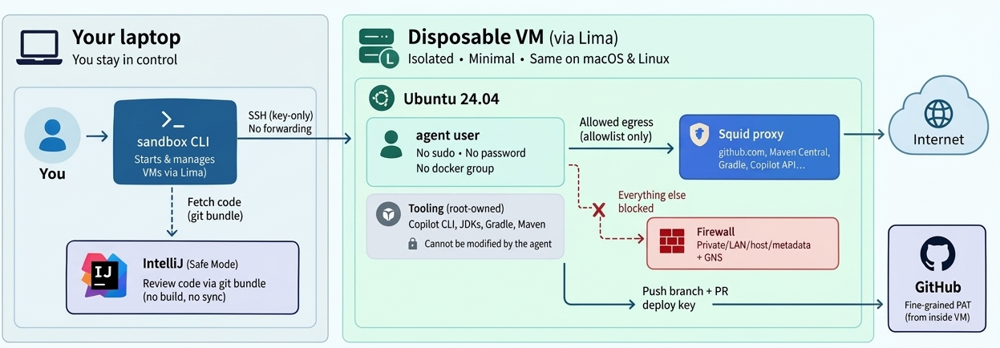

# agent-sandbox

**Run AI coding agents (showcase with GitHub Copilot CLI) on your laptop without giving them
your laptop in easy way.**

Each agent session runs in a **disposable virtual machine**:

- created by [Lima](https://lima-vm.io), identically on both systems,
- **macOS:** Apple Virtualization.framework; **Linux:** QEMU/KVM.

Each VM has:

- no shared folders,
- no SSH agent forwarding,
- no host secrets,
- an **egress allowlist**.

The agent can clone, build, test, commit, push and open a PR on its own, without approval prompts.



## Why

- An agent with "allow all" permissions runs scripts it wrote itself, build logic from
dependencies, and commands suggested by whatever it reads - including prompt injection. 
- On your host, it runs with your privileges, potentially accessing your SSH keys, AWS credentials, other repositories, 
browser data, and VPN-connected resources.  
- Reviewing every generated script is not realistic. 
- Isolation is the solution, not manual review.

### Why Disposable Virtual Machine

| | Agent on host | `copilot --sandbox` | Docker container | **Disposable VM** |
|---|---|---|---|---|
| Separate guest kernel | ✗ | ✗ | ✗ | ✔ |
| Hardware-virtualization boundary | ✗ | ✗ | ✗ | ✔ |
| Host files inaccessible by default | ✗ | policy-dependent | unless mounted | ✔ |
| Host credentials isolated | ✗ | policy-dependent | if not exposed | ✔ |
| Network egress allowlist | ✗ | URL approval | requires configuration | ✔ firewall + proxy |
| macOS + Linux support | ✔ | ✔ | ✔ | ✔ |

Details: [Threat model](docs/01-threat-model.md) · [Isolation options and why Lima](docs/02-isolation-options.md)

## Quick start

### 1. One-time host setup

```bash
git clone git@github.com:rbrisuda/agent-sandbox.git ~/agent-sandbox && cd ~/agent-sandbox
cp config/sandbox.conf.example config/sandbox.conf    # optionally change config: set GIT host, JDKs, resources …

./sandbox setup           # macOS: installs Lima via Homebrew
                          # Linux: needs Lima + QEMU + /dev/kvm access first (docs/03)
```

### 2. A sandbox — just pass repository SSH URL

```bash
./sandbox create my-project git@github.com:my-org/my-project.git   # VM + JDK + Gradle + Maven + Node + Copilot CLI
./sandbox verify my-project     # proves isolation + toolchain
./sandbox auth my-project       # deploy key (generated in the VM) -> clone, gh fine-grained PAT, Copilot login
./sandbox agent my-project --prompt "ABC-123: … Open a draft PR when the build is green."
# Ctrl-b d to detach; `./sandbox agent my-project` to re-attach
./sandbox fetch my-project      # review branches locally (no code executed) — or review the PR on GitHub
```

The URL fixes everything repository-specific: the only git host reachable over SSH, the
deploy-key page shown by `auth`, the clone in `/home/agent/work/<repo>`, and the review folder.

Full guides: [Setup (macOS + Linux)](docs/03-setup.md) ·
[Daily workflow](docs/04-daily-workflow.md)

## Commands

| Command | What it does |
|---|---|
| `sandbox setup` | One-time host prerequisites (Lima) |
| `sandbox create NAME SSH_URL [--network allowlist\|open] [--cpus/--memory/--disk]` | New VM for one repository, fully provisioned |
| `sandbox auth NAME [git\|gh\|copilot\|status]` | Credentials created **inside** the VM; the git step clones the repository |
| `sandbox clone NAME` | Clone (or fetch) the sandbox's repository into `~/work` |
| `sandbox agent NAME [--prompt T \| --prompt-file F]` | Start or attach the agent (tmux, survives disconnects) |
| `sandbox shell NAME [--admin]` / `sandbox exec NAME -- CMD` | Shell / command as `agent` (or root) |
| `sandbox put NAME FILE…` | Explicitly copy host files into `~/inbox` |
| `sandbox fetch NAME [--to PATH]` | Bring the VM's branches to `~/agent-review/NAME/<repo>` for review |
| `sandbox ide NAME` | SSH config for JetBrains Gateway / Remote Development |
| `sandbox allow NAME DOMAIN…` · `sandbox network NAME allowlist\|open\|reload` · `sandbox blocked NAME` | Egress policy |
| `sandbox verify NAME` | Isolation + toolchain self-test |
| `sandbox list\|status\|start\|stop\|provision\|destroy NAME` | Lifecycle |

## Security model in one screen

- **VM boundary.**
  - **macOS:** Virtualization.framework (`vz`); **Linux:** QEMU/KVM — both via Lima.
  - **Lima hardening:** `plain: true`, `mounts: []`, no agent/X11 forwarding, no port forwards,
    no proxy env propagation. See [docs/02](docs/02-isolation-options.md).
- **Unprivileged agent.** User `agent` has no sudo, no password and no docker group. The tools
  (Copilot CLI, JDKs, Gradle, Maven) are root-owned and cannot be modified by the agent.
- **Egress.** The agent is only allowed to talk to `127.0.0.1:3128` (squid):
  - squid allows only allowlisted domains on port 443, plus SSH to the git host.
  - Private/LAN/host/metadata ranges are always blocked.
  - Agent DNS is blocked. See [docs/05](docs/05-network-policy.md).
- **Credentials.**
  - Host → VM SSH uses a per-sandbox key that never enters the VM.
  - Git uses a **deploy key generated inside the VM**; GitHub uses a **fine-grained PAT**.
  - Everything is revocable and gone after `sandbox destroy`. See [docs/06](docs/06-credentials.md).
- **Review without execution.** Use `git bundle` fetch with IntelliJ **Safe Mode**, or a remote
  IDE whose backend runs in the VM. **Never Gradle-sync agent code on the host.** See
  [docs/07](docs/07-reviewing-in-intellij.md).
- **Branch protection on `main`** (required PR review + checks, no bypass) is the final gate.

**Residual risks:**

- data exfiltration via allowed domains (e.g. pushing to another repo the token can access),
- code you merge,
- hypervisor escapes.

See [docs/01](docs/01-threat-model.md#what-is-not-covered-residual-risks).

## Development tooling

Temurin JDKs (`JDK_VERSIONS`), Gradle and Maven are preinstalled and pre-configured for the
proxy. Gradle toolchains see all installed JDKs. Corporate Nexus, CA certificates and the
upstream proxy are covered in [docs/08](docs/08-development-tooling.md).

## Repository layout

```
sandbox                     CLI (bash 3.2+, macOS & Linux)
lib/common.sh               config, SSH, provisioning upload, network push
lib/vm.sh                   VM lifecycle via Lima (vz on macOS, qemu on Linux) — hardened YAML
guest/provision.sh          runs as root in the VM: packages, JDKs, Gradle, Maven, Copilot CLI, agent user
guest/bin/                  apply-network, agent-session, agent-run, agent-auth, verify, proxy-connect
config/defaults.conf        all settings with defaults (override in config/sandbox.conf)
config/allowlist/*.txt      domain presets: core, java, node, python, jetbrains
config/certs/, config/home/ optional CA certs / files for /home/agent
examples/                   optional Kotlin+Gradle / Java+Maven sample projects (standalone)
docs/                       the tutorial
```

## Documentation

1. [Threat model](docs/01-threat-model.md)
2. [Isolation options: VM vs container vs `--sandbox`, why Lima, Firecracker as future hardening](docs/02-isolation-options.md)
3. [Setup (macOS and Linux)](docs/03-setup.md)
4. [Daily workflow](docs/04-daily-workflow.md)
5. [Network policy](docs/05-network-policy.md)
6. [Credentials](docs/06-credentials.md)
7. [Reviewing in IntelliJ](docs/07-reviewing-in-intellij.md)
8. [Development Tooling](docs/08-development-tooling.md)
9. [Troubleshooting](docs/09-troubleshooting.md)

## Final words

- Solution is currently tested only on **macOS**.
- Tooling is oriented on "java" stack (so I can easily try it on real things in my "world"), in case of need for different tools they need to be included in guest scripts and optionally provided some configuration.
- Solution is using Github Copilot CLI, for different AI Agent needs to be included way of authentification in guest scripts.
  - However, with Github Copilot CLI it can be tested and experimented for free, only GH user is needed. :)
- **Main goal was not provide solution supporting everything (although I do not rule out further improvements towards this goal) but show real working solution, show way how tackle this problem 
  with covering as much as possible for real work scenario and providing maximum information as possible to build on that.**
  - Everything can be customized in similar way.
  - Rewriting to support different tooling and AI agent is possible.

## License

MIT — see [LICENSE](LICENSE).


