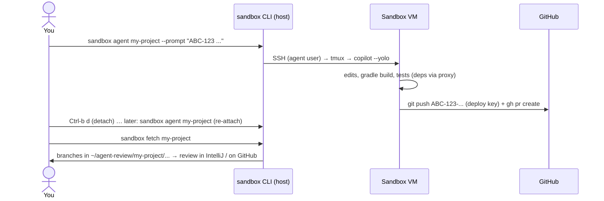

# 4. Daily workflow



## Start a task

```bash
sandbox agent my-project --prompt "ABC-123: add pagination to GET /orders. Run ./gradlew test. Open a draft PR."
# or from a file
sandbox agent my-project --prompt-file ~/tasks/ABC-123.md
# or interactive, no initial prompt
sandbox agent my-project
```

What happens:

- The VM starts if it is stopped.
- The prompt is copied into the VM (`~/.agent-sandbox/prompts/`).
- If the repository is not cloned yet, it is cloned now (needs the deploy key from `sandbox auth`).
- A **tmux** session `agent-<repo>` starts in `~/work/<repo>`, running `AGENT_CMD`
  (`copilot --yolo` by default) with the prompt.
- The agent refuses to start if the egress policy is not active (fail closed).

### Detach and re-attach

| Action | How |
|---|---|
| Detach (agent keeps working) | `Ctrl-b d` |
| Re-attach | `sandbox agent my-project` (same command) |
| Another repository | Create another sandbox: `sandbox create other git@github.com:my-org/other.git` (one repo + deploy key per sandbox) |
| Agent finished | You land in a shell in the repository. Run `agent-run .` to start the agent again, or `exit`. |

### Copilot CLI permissions inside the VM

`--yolo` (= `--allow-all-tools --allow-all-paths --allow-all-urls`) is reasonable **inside** the
sandbox, because the VM is the permission boundary. To keep some prompts, set e.g.
`AGENT_CMD="copilot --allow-all-tools"` in `config/sandbox.conf`.

## Watch, inspect, intervene

```bash
sandbox shell my-project                  # second shell as 'agent' (e.g. run tests yourself)
sandbox exec my-project -- git -C ~/work/my-project-service log --oneline -5
sandbox blocked my-project                # what did the proxy deny? (missing allowlist entries)
sandbox allow my-project registry.npmjs.org
```

## Get the results

You can review in three ways:

1. **On Git repository (simplest):** review the PR in the web UI and let CI run.
2. **Locally, without executing anything:** run `sandbox fetch my-project`.
   - It creates a `git bundle` inside the VM and fetches it into `~/agent-review/my-project/<repo>` on
     your host as `sandbox/<branch>`.
   - This also works for branches the agent did not push.
   - See [docs/07](07-reviewing-in-intellij.md).
3. **Remote IDE:** `sandbox ide my-project` lets JetBrains Gateway open the project *inside* the VM.

## Give the agent a file

```bash
sandbox put my-project ./spec/ABC-123.pdf ./api.yaml     # -> /home/agent/inbox/
```

This is the **only** way host files get into the VM, and it is explicit.

## Housekeeping

```bash
sandbox list
sandbox stop my-project                   # frees RAM; disk is kept
sandbox start my-project
sandbox destroy my-project                # VM + disk gone. Revoke the deploy key / PAT afterwards.
sandbox provision my-project              # re-apply guest config after changing config/ or guest/
```